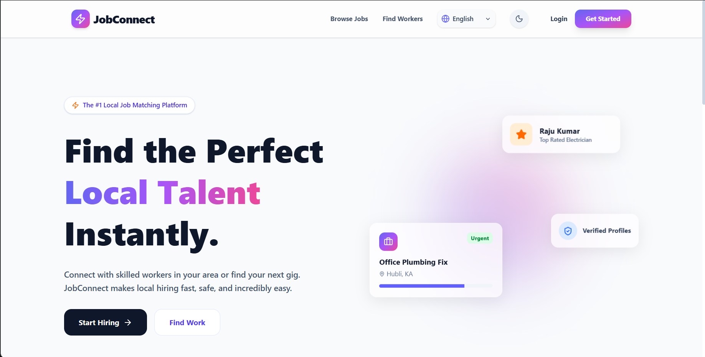
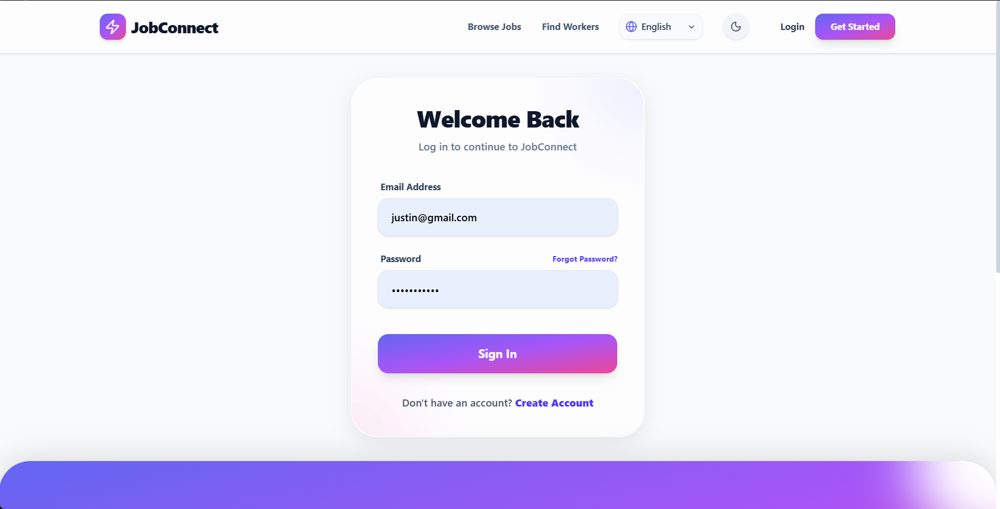
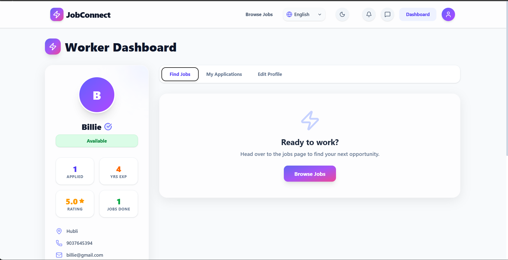
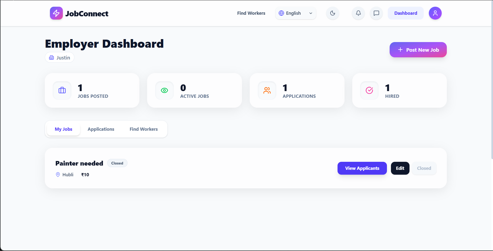
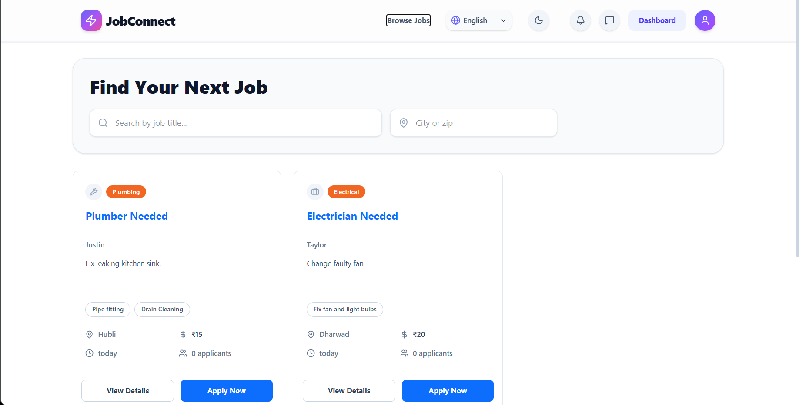
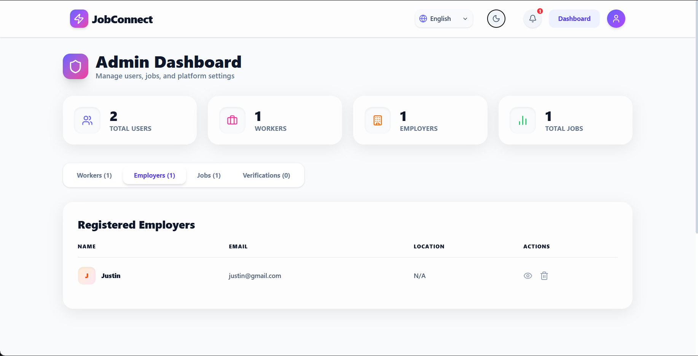

# Local Workers Job Portal

A full-stack MERN application that connects local skilled workers with employers. The platform helps workers discover employment opportunities, showcase their skills, and apply for jobs while allowing employers to publish job requirements and manage applications through a centralized interface.

The project supports **UN Sustainable Development Goal 8: Decent Work and Economic Growth** by improving access to local employment opportunities and encouraging transparent hiring.

**Live Demo:** [Local Workers Job Portal](https://local-workers-job-portal.vercel.app)

**GitHub Repository:** [local-workers-job-portal](https://github.com/vaishzz-18/local-workers-job-portal)

---

## Table of Contents

- [Overview](#overview)
- [Key Features](#key-features)
- [Technology Stack](#technology-stack)
- [Application Architecture](#application-architecture)
- [Application Screenshots](#application-screenshots)
- [Project Structure](#project-structure)
- [Getting Started](#getting-started)
- [Environment Variables](#environment-variables)
- [Running the Application](#running-the-application)
- [Deployment](#deployment)
- [Security Considerations](#security-considerations)
- [Future Enhancements](#future-enhancements)
- [Contributing](#contributing)
- [License](#license)

---

## Overview

Finding reliable local employment can be difficult for skilled workers, while employers may struggle to discover suitable candidates for short-term or skill-specific jobs.

The **Local Workers Job Portal** addresses this challenge through a web-based platform where workers and employers can interact directly.

Workers can create profiles, showcase their skills and experience, explore job listings, and apply for relevant opportunities. Employers can publish job requirements, manage listings, and review applicants. An administrative interface supports platform oversight.

The application follows a client-server architecture, using React for the frontend, Node.js and Express.js for the backend, and MongoDB for data persistence.

### Project Objectives

- Improve access to local employment opportunities.
- Help workers showcase their skills and experience.
- Simplify job posting and applicant management for employers.
- Provide role-based interfaces for workers, employers, and administrators.
- Support efficient communication and job application workflows.

## Key Features

### Worker Portal

- User registration and login.
- Worker profile creation and management.
- Skills, experience, and availability information.
- Job browsing and discovery.
- Job application workflows.
- Access to relevant application and communication features.

### Employer Portal

- Employer registration and login.
- Job posting and management.
- Applicant viewing for posted jobs.
- Hiring-related workflows through the employer interface.
- Employer profile management.

### Admin Portal

- Administrative access based on user roles.
- Platform statistics and oversight.
- User management.
- Administrative operations supported by the application.

### Authentication and Authorization

- JWT-based authentication.
- Password hashing using bcrypt.
- Role-based access for workers, employers, and administrators.
- Protected routes and authenticated application workflows.

### User Interface

- React-based single-page application.
- Client-side navigation with React Router.
- Responsive layouts.
- Toast notifications for user feedback.
- Lucide React icons.
- Theme and language interface features supported by the application.

### Communication and Media

- Socket.IO integration for real-time communication.
- Cloudinary integration for media storage and upload workflows.

---

## Technology Stack

| Layer | Technologies |
|---|---|
| Frontend | React, Vite, React Router DOM |
| Styling | Tailwind CSS and application CSS |
| HTTP requests | Axios |
| Forms and validation | React Hook Form |
| Notifications | React Hot Toast |
| Icons | Lucide React |
| Backend | Node.js, Express.js |
| Database | MongoDB, Mongoose |
| Authentication | JSON Web Tokens (JWT), bcrypt |
| Security middleware | Helmet, CORS |
| Logging | Morgan |
| Real-time communication | Socket.IO |
| Media services | Cloudinary |
| Frontend hosting | Vercel |
| Backend hosting | Render |
| Database hosting | MongoDB Atlas |

---

## Application Architecture

The application follows a client-server architecture.

```text
                  ┌────────────────────────┐
                  │      User Browser      │
                  │     React + Vite       │
                  └───────────┬────────────┘
                              │
                   HTTP / REST API Requests
                    Real-time Socket.IO
                              │
                  ┌───────────▼────────────┐
                  │    Express.js Backend  │
                  │                        │
                  │ Authentication & APIs │
                  │ Authorization Logic   │
                  │ Business Logic        │
                  └───────────┬────────────┘
                              │
                  ┌───────────▼────────────┐
                  │        MongoDB         │
                  │    Mongoose Models     │
                  └────────────────────────┘

                  External Integration:
                       Cloudinary
```

The frontend communicates with the backend through API requests. The backend processes requests, applies authentication and authorization where required, and interacts with MongoDB through Mongoose. Socket.IO supports real-time communication workflows, while Cloudinary supports media-related functionality.

### Deployment Architecture

- **Frontend:** Vercel
- **Backend:** Render
- **Database:** MongoDB Atlas
- **Media services:** Cloudinary

---

## Application Screenshots

The following screenshots will showcase the main interfaces of the Local Workers Job Portal.

> **Note:** Add the actual screenshots to `docs/screenshots/` using the filenames below. The images will appear here automatically once the files are committed to GitHub.

### 1. Home Page



### 2. Login Page



### 3. Worker Dashboard



### 4. Employer Dashboard



### 5. Job Listings



### 6. Admin Dashboard



---

## Project Structure

```text
local-workers-job-portal/
├── backend/
│   ├── config/
│   ├── controllers/
│   ├── middleware/
│   ├── models/
│   ├── routes/
│   ├── utils/
│   ├── server.js
│   ├── package.json
│   └── package-lock.json
│
├── frontend/
│   ├── public/
│   ├── src/
│   │   ├── assets/
│   │   ├── components/
│   │   ├── context/
│   │   ├── pages/
│   │   ├── App.jsx
│   │   └── main.jsx
│   ├── index.html
│   ├── package.json
│   ├── package-lock.json
│   └── vite.config.js
│
├── docs/
│   └── screenshots/
│
├── .gitignore
├── package.json
├── package-lock.json
└── README.md
```

The directory tree is representative. Some files and subdirectories may differ in the actual repository.

---

## Getting Started

### Prerequisites

Install the following before running the application locally:

- [Node.js](https://nodejs.org/) — preferably a supported LTS release.
- npm, included with Node.js.
- A [MongoDB Atlas](https://www.mongodb.com/atlas) cluster or another compatible MongoDB instance.
- [Git](https://git-scm.com/).

### 1. Clone the Repository

```bash
git clone https://github.com/vaishzz-18/local-workers-job-portal.git
cd local-workers-job-portal
```

If the repository is private, make sure you have permission to access it.

### 2. Install Backend Dependencies

```bash
cd backend
npm install
```

### 3. Configure Backend Environment Variables

Create a `.env` file inside the `backend/` directory. Configure the following variables with your own values:

```env
PORT=5000
NODE_ENV=development
MONGO_URI=your_mongodb_connection_string
JWT_SECRET=your_strong_random_secret
FRONTEND_URL=http://localhost:5173
CLOUDINARY_CLOUD_NAME=your_cloudinary_cloud_name
CLOUDINARY_API_KEY=your_cloudinary_api_key
CLOUDINARY_API_SECRET=your_cloudinary_api_secret
```

Use only the variables required by your current backend implementation. The Cloudinary variables are needed when the associated media functionality is enabled.

**Never commit real credentials, database connection strings, or secret keys to GitHub.**

### 4. Install Frontend Dependencies

Open a second terminal from the repository root:

```bash
cd frontend
npm install
```

Create `frontend/.env` if needed and configure the backend URL:

```env
VITE_API_URL=http://localhost:5000
```

Vite exposes variables prefixed with `VITE_` to frontend code. Do not put private credentials in frontend environment variables.

---

## Running the Application

### Start the Backend

From the `backend/` directory:

```bash
npm run dev
```

The backend should start on port `5000`, unless another port is configured.

### Start the Frontend

From the `frontend/` directory, in a separate terminal:

```bash
npm run dev
```

Open the local URL printed by Vite, typically:

```text
http://localhost:5173
```

Keep both development servers running while using the local application.

---

## Deployment

The application is deployed using Vercel, Render, and MongoDB Atlas.

### Backend — Render

The backend is hosted on Render.

**Deployment URL:** [https://local-workers-job-portal.onrender.com](https://local-workers-job-portal.onrender.com)

To deploy the backend:

1. Connect the GitHub repository to Render.
2. Create a Web Service.
3. Set the root directory to `backend`.
4. Set the build command to `npm install`.
5. Set the start command to `npm start`.
6. Configure the required environment variables in the Render dashboard.
7. Ensure the backend can connect to MongoDB Atlas.
8. Verify the deployment logs and test the API.

Configure the production environment variables in Render rather than committing them to the repository.

Typical variables include:

```env
NODE_ENV=production
MONGO_URI=your_production_mongodb_connection_string
JWT_SECRET=your_production_secret
FRONTEND_URL=https://local-workers-job-portal.vercel.app
CLOUDINARY_CLOUD_NAME=your_cloudinary_cloud_name
CLOUDINARY_API_KEY=your_cloudinary_api_key
CLOUDINARY_API_SECRET=your_cloudinary_api_secret
```

Add `PORT` only if required by the hosting configuration; Render normally provides it through the environment.

### Frontend — Vercel

The frontend is hosted on Vercel.

**Deployment URL:** [https://local-workers-job-portal.vercel.app](https://local-workers-job-portal.vercel.app)

Deployment configuration:

- Root directory: `frontend`
- Build command: `npm run build`
- Output directory: `dist`
- Environment variable: `VITE_API_URL`

Set the production API URL in Vercel:

```env
VITE_API_URL=https://local-workers-job-portal.onrender.com
```

After changing environment variables, redeploy the frontend if required.

### Database — MongoDB Atlas

MongoDB Atlas provides the application's database hosting.

Ensure that:

- The backend uses the correct MongoDB connection string.
- Database credentials are stored securely.
- Network access is configured appropriately for the deployed backend.
- The database user has only the permissions it needs.

---

## Security Considerations

The application uses JWT-based authentication and bcrypt password hashing. Additional security practices for deployment include:

- Keep `.env` files out of version control.
- Store production secrets in the hosting provider's environment settings.
- Use a strong, randomly generated JWT secret.
- Rotate credentials that may have been exposed.
- Restrict database access and use least-privilege database credentials.
- Configure CORS to permit only intended frontend origins.
- Apply authentication and role-based authorization to protected backend routes.
- Validate and sanitize user input on the server.
- Protect administrative operations from unauthorized users.
- Avoid exposing private credentials in client-side code or logs.
- Check Git history for previously committed secrets before making the repository public.

**Security note:** These practices are recommendations and do not, by themselves, constitute a complete security audit.

---

## Future Enhancements

Potential areas for further development include:

- Advanced job search and filtering.
- Location-based job discovery.
- Email notifications for job and application updates.
- Improved accessibility and mobile usability.
- Automated testing and continuous integration.
- Enhanced analytics for employers and administrators.
- Additional worker and employer profile capabilities.

These are proposed enhancements, not claims that every feature is currently implemented.

---

## Contributing

Suggestions, bug reports, and contributions are welcome.

1. Fork the repository, if you have access.
2. Create a feature branch.
3. Make and test your changes.
4. Commit changes with a descriptive message.
5. Open a pull request describing the improvement.

---

## License

No license has been specified for this repository yet.

If you intend to distribute the project as open-source software, choose an appropriate license and add a `LICENSE` file. Until then, do not assume that others have permission to reuse or redistribute the code.
